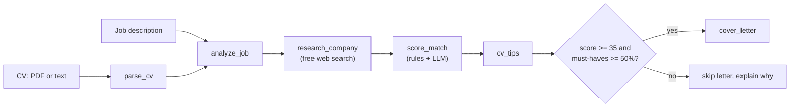

# Job Application Copilot


An LLM agent that reads your CV and a job description, then returns a **match score**, **CV improvement tips**
and a **tailored cover letter**. It runs entirely on free tools (Groq or Gemini free tiers, or local Ollama).

**Live demo:** https://job-application-copilot-sf86ffmrusr7uusoctmbn2.streamlit.app/

<!-- Add a screenshot or GIF here:  -->

## Why this project
Most LLM demos stop at "call an API". This one focuses on what makes LLM apps trustworthy:

- **Validated output**: every LLM answer is parsed into Pydantic models, with automatic retry on bad JSON.
- **Evidence behind the score**: a rule-based skill matcher checks the CV against the job's must-have skills, and the LLM scores with that evidence in hand.
- **Honesty guard-rails**: the agent refuses to write a cover letter for a weak fit, and a check flags any number in a letter that is not in the CV.
- **Measured, not guessed**: an evaluation suite with an LLM judge, plus tracing of every model call.
- **Provider-agnostic**: switch between Groq, Gemini and Ollama with one environment variable.

## Architecture



Built with **LangGraph** (workflow), **Pydantic** (schemas), **PyMuPDF** (CV parsing), **Streamlit** (UI),
**pytest + GitHub Actions** (tests and CI), **Docker**.

## Run it

```bash
python -m venv .venv
# Windows: .venv\Scripts\activate    |  Mac/Linux: source .venv/bin/activate
pip install -r requirements.txt
cp .env.example .env        # Windows: copy .env.example .env, then add a free API key
streamlit run app.py        # web app at http://localhost:8501
```

Command line version:

```bash
python scripts/step2_demo.py --cv data/cv_samples/my_cv.pdf --job data/job_samples/job1.txt
```

With Docker:

```bash
docker build -t job-copilot .
docker run --rm -p 8501:8501 --env-file .env job-copilot
```

Switch provider with `LLM_PROVIDER=groq|gemini|ollama` in `.env`. Run `python scripts/list_models.py` to see which model names your account can use.

## Evaluation

```bash
python evals/run_evals.py --limit 3     # quick run
python evals/run_evals.py               # all 7 cases
```

Each case pairs a synthetic CV with a job and checks the score range, whether a cover letter was (not) written,
numbers in the letter that are not in the CV, and an LLM-judge rating (1-5) for relevance, honesty and tone.
Every model call is traced (latency, tokens, failures) to `output/traces.jsonl`.

### Baseline run (before the coverage gate below)

Model: `openai/gpt-oss-20b` on Groq's free tier, 7 cases.

| Case | Score | Expected | Letter | Judge (relevance / honesty / tone) |
|---|---|---|---|---|
| strong ML CV vs ML job | 90 | 70-100 | written | 5 / 5 / 5 |
| strong ML CV vs data analyst job | 50 | 35-85 | written | 3 / 5 / 4 |
| web dev CV vs full-stack job | 90 | 70-100 | written | 5 / 5 / 5 |
| web dev CV vs ML job | 30 | 0-40 | skipped | - |
| beginner CV vs ML job | 25 | 0-35 | skipped | - |
| beginner CV vs data analyst job | 30 | 15-65 | skipped | - |
| strong ML CV vs full-stack job | 35 | 15-60 | written | 2 / 5 / 4 |

All 7 scores landed in their expected range, weak candidates were routed correctly, no letter contained an
unsupported number, and judged honesty averaged 5.0. Relevance averaged 3.75, the weakest dimension.

**What the evaluation found:** in the last case the candidate had 2 of 5 must-have skills (none of JavaScript, React, Node.js)
but scored exactly at the cut-off, so a cover letter was written and the judge rated its relevance 2/5.
A score threshold alone was not enough, so the agent now also skips the letter when fewer than 50% of the
must-have skills are covered. The 50% value is a judgment call and can be tuned in `copilot/graph.py`.
Re-run results after the fix: see [`evals/RESULTS.md`](evals/RESULTS.md).

### Limitations
- 7 synthetic cases is a small sample; scores come from one model on a free tier.
- The judge is the same model family as the agent, so its ratings can be biased in its favor.
- The judge also penalises letters for not claiming skills the candidate lacks, which is the honest behaviour.
- Skill matching is word-based, so it can miss synonyms (for example "ML" vs "machine learning").
- The number check flags figures that are not in the CV, but cannot detect invented non-numeric claims.

## Project layout

```
app.py                 Streamlit web app
copilot/               graph.py (workflow), llm.py, tools.py, schemas.py, evaluation.py, tracing.py, ...
evals/                 test cases, runner and results
scripts/               command line demos
tests/                 pytest suite (the LLM is simulated, so no API key is needed)
.github/workflows/     CI: tests on every push
Dockerfile
```

## Roadmap
- [x] LLM layer, CV parsing, structured extraction
- [x] LangGraph agent, tools, report
- [x] Evaluation suite and tracing
- [x] Streamlit UI and deployment
- [x] Docker and CI
- [ ] Synonym-aware skill matching
- [ ] More and real-world evaluation cases

## Privacy
The app sends your CV and the job text to the configured LLM provider and does not save them to a file or database.
